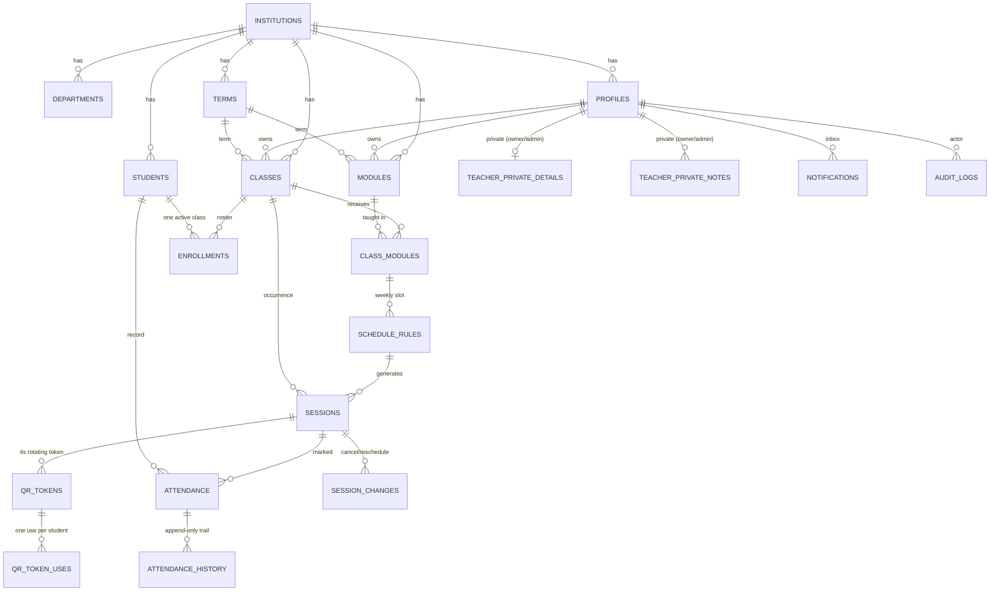

# ClassTrack — PostgreSQL / Supabase database design

**Status:** implementation-ready · **Target:** Supabase Postgres 15+ · **Supersedes:** [`03-database-schema.sql`](./03-database-schema.sql)

---

## 1. What changed and why

This design replaces the single draft SQL file with a versioned Supabase migration set. It implements the requested model explicitly:

| Requirement | Implementation |
|---|---|
| Teachers own classes **and modules** | `classes.teacher_id`, `modules.owner_teacher_id`; ownership helpers in RLS |
| Students belong to one class | Partial unique index `enrollments_one_active_class_per_student_uq` |
| Teachers teach multiple modules/classes | `class_modules` join + `schedule_rules.class_module_id`; a session's `teacher_id` is the module owner |
| Weekly recurrence generates real sessions | `schedule_rules` → `rpc_generate_sessions()` → `sessions` (holiday-aware, idempotent) |
| Cancel / reschedule | `rpc_change_session()` + `session_changes` audit; cancelled rows never counted |
| Attendance: present / absent / late / **justified** | `attendance_status` enum, `late_minutes`, `notes`, `justification_reason`, `justification_url` |
| QR tokens valid **4 seconds** | `institutions.qr_token_ttl_seconds DEFAULT 4`; `qr_tokens` stores only SHA-256 hashes |
| Administrators see establishment reports | `v_institution_summary`, `v_daily_attendance`, `v_teacher_performance` + admin-only RLS on audit data |
| Teacher privacy | Public fields in `profiles`; private data only in `teacher_private_details` / `teacher_private_notes` (owner + admin) |
| Students cannot edit attendance | No INSERT/UPDATE/DELETE grant or RLS policy on `attendance`; check-in is a `SECURITY DEFINER` RPC bound to `auth.uid()` |

Two intentional deviations from the older docs: tokens rotate every **4 seconds** (was 20) and the status is **`justified`** (was `excused`), matching the request. Check-in accepts a token only until its `expires_at`; there is no client-clock trust and no grace period beyond the configured 4 seconds.

---

## 2. Where the SQL lives

```
supabase/
├── config.toml                                    # Supabase CLI local config
├── migrations/
│   ├── 20261126000001_classtrack_core.sql        # enums, tables, constraints, triggers, views
│   ├── 20261126000002_classtrack_functions.sql   # auth helpers + privileged RPCs
│   └── 20261126000003_classtrack_rls.sql         # RLS policies, grants, realtime publication
└── seed.sql                                       # LOCAL fixtures (supabase db reset)
```

Apply locally with:

```bash
cd Desktop/trackabsence
supabase start
supabase db reset        # migrations + seed.sql
```

For a hosted project: `supabase link --project-ref <ref>` then `supabase db push` (migrations only; **never** push the seed to production).

The React app currently uses `src/data/mockData.js`. The database mirrors that vocabulary (`CS-301`, Northbridge University, Amina El Fassi, Karim Bennis, Yasmine Ait Ali) so the UI can be wired to Supabase queries without renaming domain concepts.

---

## 3. Entity relationship overview



**Core distinction:** a *module* is what is taught (owned by a teacher); a *class* is who is taught (owned by a teacher). `class_modules` connects them, so a teacher can teach several modules and several classes, and one class can contain modules taught by different teachers. A student's `enrollments` row always points at a class, never directly at a module.

---

## 4. Relational schema

All tenant tables carry `institution_id`. Most child tables also use composite foreign keys such as `(institution_id, class_id) → classes(institution_id, id)`, so a row can never be linked across establishments.

### 4.1 Tenant root and calendar

| Table | PK | Important FKs | Constraints / indexes |
|---|---|---|---|
| `institutions` | `id` | — | unique `slug`; configurable `timezone`, check-in window, `qr_token_ttl_seconds = 4`, edit window, risk thresholds; `critical < warning` |
| `departments` | `id` | `institution_id` | unique `(institution_id, code)`, unique `(institution_id, id)` |
| `terms` | `id` | `institution_id` | unique `(institution_id, name)`, `ends_on > starts_on` |
| `holidays` | `id` | `institution_id` | unique `(institution_id, holiday_date)`; skipped by session generation |

### 4.2 People and privacy

| Table | PK | Important FKs | Constraints / indexes |
|---|---|---|---|
| `profiles` | `id` → `auth.users(id)` | `institution_id`, `department_id` | unique `(institution_id, email)`, unique `(institution_id, id)`; indexes on `(institution_id, role)`, `department_id` |
| `teacher_private_details` | `teacher_id` → `profiles(id)` | `institution_id` | trigger enforces owner is a teacher in the same institution; only owner/admin can read |
| `teacher_private_notes` | `id` | `institution_id`, `owner_teacher_id` | `entity_type ∈ {student,class,module,session}`; owner-only index |
| `students` | `id` | `institution_id`, optional `profile_id` | unique numbers/emails per institution; generated `search_tsv` + GIN index; risk index |

> Self-service profile updates are limited by **column grants** to `first_name, last_name, title, avatar_url, department_id`. `role`, `institution_id` and `status` cannot be changed by a client — RLS alone cannot prevent column escalation.

### 4.3 Teaching model

| Table | PK | Important FKs | Constraints / indexes |
|---|---|---|---|
| `modules` | `id` | `(institution_id, term_id)`, `(institution_id, owner_teacher_id)` | unique `(institution_id, term_id, code)`; owner index |
| `classes` | `id` | `(institution_id, term_id)`, `(institution_id, teacher_id)` | unique `(institution_id, term_id, code)`; teacher/term indexes |
| `class_modules` | `id` | `(institution_id, class_id)`, `(institution_id, module_id)`, `(id, class_id)` | unique `(class_id, module_id)` |
| `enrollments` | `id` | `(institution_id, class_id)`, `(institution_id, student_id)` | unique `(class_id, student_id)`; **partial unique on `student_id` where active** |
| `schedule_rules` | `id` | class + class_module; `(class_module_id, class_id)` | ISO weekday 1–7, `ends > starts`, valid window; index `(class_id, weekday)` |

Transferring a student between classes = set old enrollment `status='dropped'` and insert a new active row (the partial unique index enforces one active class).

### 4.4 Sessions, attendance, QR

| Table | PK | Important FKs | Constraints / indexes |
|---|---|---|---|
| `sessions` | `id` | class, module link, teacher, self `rescheduled_to` | `ends_at > starts_at`; cancellation reason required; unique `(schedule_rule_id, starts_at)` makes generation idempotent; indexes on class/time, teacher/time, live status |
| `attendance` | `id` | `(institution_id, session_id)`, `(institution_id, student_id)` | unique `(session_id, student_id)`; `late ⇒ late_minutes 1..1440`; `justified ⇒ justification_reason`; evidence only when justified; trigger blocks cancelled/rescheduled sessions |
| `attendance_history` | identity `id` | `institution_id`, actor | append-only; stores before/after JSON for every insert/update |
| `qr_tokens` | `id` | `(institution_id, session_id)` | unique `token_hash`; `expires_at`; no client policy/grant |
| `qr_token_uses` | `id` | token + student | unique `(token_id, student_id)` → a token can serve many students but each student only once |

**QR flow:** `rpc_issue_qr_token()` creates a 192-bit random token, returns the raw value once, stores only `sha256(token)`, and sets `expires_at = now() + 4s`. `rpc_check_in()` hashes the presented token, requires `expires_at > now()`, verifies the session is `live`, `qr_enabled`, inside the institution window, verifies enrollment, records one token use, then inserts attendance (`present` within punctuality grace, otherwise `late` with minutes). Expired/replayed/tampered values simply fail the hash lookup.

### 4.5 Operational tables

`session_changes` (reason + before/after), `notifications` (per-user inbox), `audit_logs` (append-only privileged mutations), `report_exports` (filter snapshot + file path), `import_jobs` and `timetable_import_drafts` (raw AI output, extracted rows, teacher corrections) — all institution-scoped and RLS-protected.

---

## 5. Index and constraint strategy

- **Tenant isolation:** denormalized `institution_id` on every table plus composite FKs to parent `(institution_id, id)` keys.
- **Idempotence:** unique `(schedule_rule_id, starts_at)`, unique `(session_id, student_id)`, unique `(class_id, student_id)`, unique `(token_id, student_id)`.
- **Hot paths:** `(class_id, starts_at DESC)`, `(teacher_id, starts_at DESC)`, partial live-session index, `(session_id, student_id)` unique index used by check-in upserts, GIN `search_tsv` for roster search.
- **Append-only guarantees:** no client write grants on `attendance_history`, `audit_logs`, `session_changes`, `qr_tokens`, `qr_token_uses`.
- **Soft deletes:** `deleted_at` on classes, students, enrollments, modules, institutions; every read policy and view filters it.

---

## 6. Scheduled session generation

`rpc_generate_sessions(p_class_id, p_from, p_to, p_replace_future)`:

1. Authorizes admin, class owner, or a teacher owning a module in that class.
2. Optionally deletes **future, untouched, scheduled** occurrences when a timetable is edited (past/completed/cancelled rows are preserved).
3. For every active rule, expands dates with `generate_series`, filters by ISO weekday and institution holidays, converts local wall-clock time to `timestamptz` using the institution timezone, and inserts sessions.
4. `ON CONFLICT (schedule_rule_id, starts_at) DO NOTHING` makes re-runs safe.

Suggested `pg_cron` wiring (run in Supabase SQL editor, adjust schedule):

```sql
-- every minute: promote scheduled -> live, close live sessions past end time
select cron.schedule('classtrack-session-sweep', '* * * * *', $$
  update public.sessions set status = 'live', opened_at = coalesce(opened_at, now()), updated_at = now()
   where status = 'scheduled' and now() >= starts_at;
  update public.sessions set status = 'completed', closed_at = now(), qr_enabled = false, updated_at = now()
   where status = 'live' and now() >= ends_at;
$$);
```

Attendance auto-absence is already implemented in `rpc_close_session()`; a cron variant can call the same function for sessions that just ended.

---

## 7. RLS policy matrix

| Table | Teacher | Admin | Student |
|---|---|---|---|
| `institutions`, `departments`, `terms`, `holidays` | read own institution | read + write | read own institution |
| `profiles` | read self only; update own public columns only | read + manage | read self only; update own public columns |
| `v_user_directory` | read public directory fields | read all | read public directory fields |
| `teacher_private_details`, `teacher_private_notes` | **own rows only** | read + write | none |
| `students` | read/update students enrolled in own classes; insert | all | read own row only |
| `modules` | read/insert/update own | all | read modules attached to own class |
| `classes` | read own / taught / enrolled; insert & update owned | all | read own class |
| `class_modules`, `schedule_rules` | manage for owned classes / own modules | all | read for own class |
| `sessions` | read taught/owned; mutations via RPC only | all | read own class sessions |
| `attendance` | read for sessions taught/owned; **write via RPC only** | read + correct via RPC | **read own rows only** |
| `attendance_history` | read for managed sessions | read all | read own rows |
| `qr_tokens`, `qr_token_uses` | **none** | none via client (service role/RPC only) | none |
| `session_changes` | read visible sessions | read all | read own class |
| `notifications` | own inbox | own inbox | own inbox |
| `audit_logs` | none | read all institution rows | none |
| `report_exports`, `import_jobs`, `timetable_import_drafts` | own requests | all | none |

All policies are `to authenticated` and, except for `institutions`, begin with `institution_id = public.current_institution_id()`. Helper functions are `SECURITY DEFINER` with `search_path = public, pg_temp`, which avoids both RLS recursion and search-path hijacking. `auth.role() = 'service_role'` and the local migration roles are treated as administrators for server-side work.

**Guarantee checks**

- Teacher B cannot `SELECT` teacher A's `teacher_private_details`/`teacher_private_notes`: policies require `owner_teacher_id = auth.uid()` (or admin).
- Teacher B cannot `SELECT` teacher A's classes, rosters or attendance: `can_manage_class`/`can_view_class` require ownership, module teaching, or enrollment.
- A student cannot `UPDATE`/`INSERT`/`DELETE` `attendance`: no policy and no column privilege exist. The only write path is `rpc_check_in()`, which derives the student from `auth.uid()`.
- A teacher cannot escalate `profiles.role` to `admin`: no UPDATE privilege on that column.
- A student cannot create a class/module to become an "owner": every ownership branch in `can_manage_class`, `owns_module`, and the INSERT policies requires `is_teacher()`; a trigger additionally rejects non-teacher owners even for service-role imports.

---

## 8. Roles and permission model

| Role | Stored in | Capabilities |
|---|---|---|
| `teacher` | `profiles.role` | Owns classes and modules, manages rosters/timetables, starts/closes sessions, marks attendance within the edit window, issues QR tokens, reads own reports |
| `admin` | `profiles.role` | Institution-wide read/write, global reports, audit log, teacher management, attendance corrections with mandatory reason, class reassignment |
| `student` | `profiles.role` | Reads own student record and attendance, checks in via QR, reads own class/session schedule |
| service role / migrations | JWT `service_role` / local `postgres` | Bypasses RLS for Edge Functions, cron and bootstrap; all privileged RPCs also verify authorization |

Roles are deliberately **not** taken from client-supplied JWT metadata; `current_app_role()` reads the trusted `profiles` row. Adding institution id to `app_metadata` is optional for JWT-claim optimization, but RLS does not depend on it.

### RPC catalog

| Function | Purpose | Allowed caller |
|---|---|---|
| `attendance_rate` | Weighted rate calculation | authenticated |
| `rpc_generate_sessions` | Expand weekly rules into sessions | admin / class owner / module teacher |
| `rpc_current_session` | Server-time live/next sessions | teacher / admin |
| `rpc_start_session`, `rpc_close_session` | Lifecycle + auto-absence | session teacher / class owner / admin |
| `rpc_change_session` | Cancel or reschedule with audit | session teacher / class owner / admin |
| `rpc_issue_qr_token` | Issue 4-second opaque token | session teacher / admin |
| `rpc_check_in` | Validate token, enrollment, window; insert attendance | student only |
| `rpc_save_attendance` | Batch save with edit-window enforcement | teacher / admin |
| `rpc_admin_correct_attendance` | Override attendance with mandatory reason | admin only |

---

## 9. Reporting

`security_invoker = true` views keep RLS intact while providing aggregates:

- `v_user_directory` — definer view with non-sensitive directory columns only; avoids exposing `profiles` rows or teacher performance to other users.
- `v_class_attendance` — students, sessions held, status counts, weighted rate per class.
- `v_student_attendance` — per-student counts/rate/risk (used for at-risk lists).
- `v_teacher_performance` — classes, students, status counts, rate per teacher.
- `v_daily_attendance` — institution × department × local day trend (cancelled sessions excluded).
- `v_institution_summary` — institution KPIs for the administrator dashboard.

Every rate uses `(present + 0.5 × late) / (present + late + absent)`; `justified` and cancelled sessions are excluded from the denominator.

---

## 10. Example seed data

`supabase/seed.sql` creates:

- **Northbridge University**, `Africa/Casablanca`, 4-second QR TTL, 10/15-minute check-in window, 5-minute punctuality grace, 75/60 risk thresholds.
- Departments CS, ENG, MTH; active term **Fall 2026**; one holiday.
- 2 teachers (Amina El Fassi, Daniel Okafor), 1 admin (Karim Bennis), 6 students with login. Password for all: `DemoPass123!`.
- 3 teacher-owned modules (`CS-301`, `CS-305`, `MTH-204`) and 3 owned classes; `MTH-204` is taught by Daniel inside Amina's `CS-301-A` class to demonstrate module/class ownership separation.
- 6 enrollments (one active class each), 5 weekly rules, generated sessions for 23–27 Nov 2026, one live session, two completed sessions, one cancelled session.
- Example attendance rows for `present`, `late` (7 minutes + teacher note), and `justified` (reason), plus teacher private details and a private note.

Run `supabase db reset` to recreate the local database deterministically.

---

## 11. Verification checklist

```sql
-- as teacher A: should return 0 rows for another teacher's private data
select * from public.teacher_private_details;

-- as a student: should return own attendance only
select a.status, a.late_minutes from public.attendance a;

-- as a student: must fail (permission denied / no policy)
update public.attendance set status = 'present' where student_id = auth.uid()::uuid;

-- issue a token as the owning teacher, then check in as an enrolled student
select * from public.rpc_issue_qr_token('<live session uuid>');
select * from public.rpc_check_in('<raw token from previous call>');

-- token replay after 4 seconds must fail; a second scan by the same student must fail
-- module teacher vs class owner: Daniel sees CS-301-A sessions but not Amina's roster
select * from public.classes;
select * from public.students;
```

Add these as RLS integration tests in CI (Supabase local + two JWTs per role) before every deploy; a policy typo is the highest-risk failure mode in this design.
